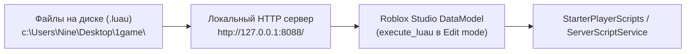

# 🏰 Обзор проекта: Roblox Voxel Cat RPG

## 1. Концепция и жанр
**Roblox Voxel Cat RPG** — уютная изометрическая ролевая песочница в воксельном пиксельном стиле. Игрок управляет очаровательным чёрным котиком с большими выразительными глазами и белыми носочками на лапках. Котик исследует воксельный остров, добывает лапками ресурсы (траву, дерево, камень, глину, песок, руду), строит блоки, ловит рыбу и собирает ягоды.

---

## 2. Архитектура файлов проекта

| Файл | Назначение | Расположение в Roblox Studio |
| :--- | :--- | :--- |
| [`PixelCharacter.luau`](../PixelCharacter.luau) | Процедурная 3D-модель котика, процедурная анимация походки/рыси/копания/строительства, IK-примагничивание лапок к земле, физика | `StarterPlayer.StarterCharacterScripts.PixelCharacter` |
| [`VoxelClient.luau`](../VoxelClient.luau) | Деревянный пиксельный HUD (9 слотов, колбы витальности, кнопка рюкзака, полоса опыта), экран инвентаря на лесной поляне, рейкастинг выбора цели мыши, ввод | `StarterPlayer.StarterPlayerScripts.VoxelClient` |
| [`VoxelServer.luau`](../VoxelServer.luau) | Серверная воксельная сетка мира, процедурная генерация блоков, разрушение и добыча ресурсов, инвентарь игрока (54 слота), сетевые события | `ServerScriptService.VoxelServer` |
| [`IsometricCamera.luau`](../IsometricCamera.luau) | Фиксированная плавная изометрическая камера следования за котиком под углом 45 градусов | `StarterPlayer.StarterPlayerScripts.IsometricCamera` |
| [`AGENTS.md`](../AGENTS.md) | Главная инструкция для всех AI-агентов | Корень репозитория |
| [`agent_history/`](./) | Папка полной истории действий, спецификаций и журнала разработки | Корень репозитория |

---

## 3. Схема синхронизации с Roblox Studio

Roblox Studio работает с локальными файлами через MCP-инструменты и локальный PowerShell HTTP-сервер:

- **Порт сервера:** `http://127.0.0.1:8088/`
- **Маршруты:**
  - `/client` -> `VoxelClient.luau`
  - `/server` -> `VoxelServer.luau`
  - `/character` -> `PixelCharacter.luau`
- **Важное правило:** Обновление скриптов всегда происходит в режиме **Edit** DataModel, после чего игра может запускаться для тестов в **Play**, а затем обязательно возвращается в **Edit**.
